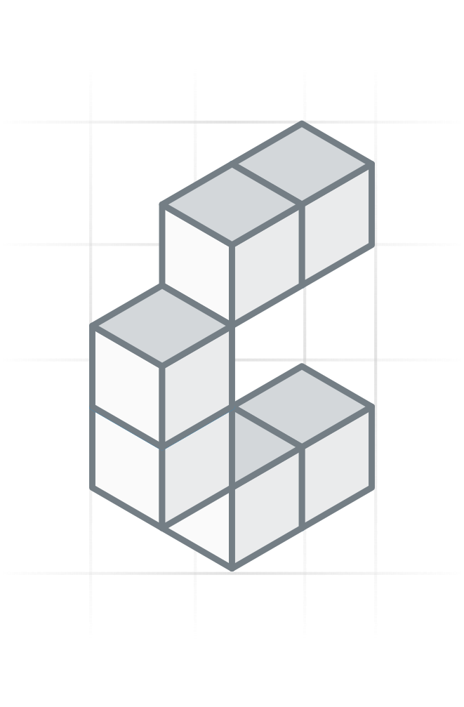

# agentic-server

<p align="center" width="100%">
  
</p>

<p align="center" width="100%">
  <a href="https://github.com/constructive-io/constructive/actions/workflows/run-tests.yaml">
    
  </a>
   <a href="https://github.com/constructive-io/constructive/blob/main/LICENSE"></a>
   <a href="https://www.npmjs.com/package/agentic-server"></a>
</p>

Standalone, OpenAI-compatible LLM gateway — a stateless multi-provider proxy with pluggable inference metering.

## Overview

`agentic-server` is a small Express app that accepts OpenAI-compatible requests, routes them to a configured LLM provider (OpenAI, Anthropic, or Ollama), normalizes the response back to the OpenAI shape, and records usage through an injected sink. It is **backend-agnostic**: the gateway never imports a concrete telemetry/billing implementation — callers inject an `InferenceSink`, so the same gateway can meter to `compute_log`, a billing service, or nothing at all.

## Usage

```typescript
import { createAgenticServer } from 'agentic-server';

const app = createAgenticServer({
  providerType: 'ollama',
  providerBaseUrl: 'http://localhost:11434',
  defaultModel: 'llama3',
  // Optional: record usage. Fire-and-forget; implementations must never throw.
  inferenceSink: { logInference: (entry) => myBackend.record(entry) },
});

app.listen(3001, () => {
  console.log('agentic-server running on :3001');
});
```

## Endpoints

| Method | Path | Description |
|--------|------|-------------|
| POST | `/v1/chat/completions` | OpenAI-compatible chat completion (multi-provider) |
| POST | `/v1/embeddings` | OpenAI-compatible embeddings (multi-provider) |
| POST | `/v1/usage` | Submit an external usage report to the metering sink |
| GET | `/v1/providers` | List configured providers |
| GET | `/healthz` | Health check |

## Streaming

`POST /v1/chat/completions` with `stream: true` is relayed as a `text/event-stream`: the gateway forwards the provider's frames verbatim, so a client receives tokens as they are produced. It adds `stream_options: { include_usage: true }` unless the caller set `stream_options` itself, and meters the usage the final frame carries. Streaming is available for OpenAI-compatible providers; a provider whose stream would need translation (`ollama`, `anthropic`) is rejected `501` rather than answered with a non-streaming body.

## Providers and routing

`providers` is a registry; each entry has a `type` (the dialect: `openai`, `anthropic`, `ollama`) and an optional `name` it is addressed by, which defaults to the type. Two entries of one dialect — an in-cluster Ollama and one on a GPU host — are both reachable by name:

```typescript
createAgenticServer({
  providers: [
    { name: 'ollama', type: 'ollama', baseUrl: 'http://ollama:11434' },
    { name: 'host-ollama', type: 'ollama', baseUrl: 'http://host.docker.internal:11434' },
    { type: 'openai', baseUrl: 'https://api.openai.com', apiKey: process.env.OPENAI_API_KEY }
  ]
});
```

A request picks its provider, in this order: the `X-LLM-Provider` header (a name, or a type for an entry with no name); a `name/model` prefix such as `host-ollama/qwen3:8b` (stripped before the call goes upstream); a known model family (`claude*` → anthropic; `gpt-oss*`, `llama*`, `mistral*`, `gemma*`, `nomic*`, `qwen*`, `glm*` → ollama; `gpt*`, `o1*`, `o3*` → openai); otherwise the first entry.

### The Ollama dialect

A request to an `ollama` provider is rewritten for `/api/chat`: content parts are flattened to the string Ollama takes; `max_tokens` becomes `options.num_predict` and `num_ctx` becomes `options.num_ctx` (a client `options` object is merged under them); `tools`, `think` and `keep_alive` are forwarded as-is; `response_format` becomes `format` (`json_object` → `'json'`, `json_schema` → the schema; a native `format` is passed through). The reply comes back in the OpenAI shape, including `tool_calls` (arguments as a JSON string, `finish_reason: 'tool_calls'`) and `reasoning_content` for a `thinking` message, so a tool-calling harness can run on an Ollama-served model.

## Identity & tenancy

Requests carry tenant identity via headers: `X-Database-Id` (**required** — requests without it are rejected `400`), `X-Entity-Id`, and `X-Actor-Id`. Routing to a specific provider can be forced with `X-LLM-Provider`.

`isPublic` controls trust: when `false` (default) the server sits on a private network and trusts these headers directly; when `true` the identity headers are stripped from incoming requests (external clients cannot set tenant context), so such requests fail loud rather than being mis-attributed.

## Metering

Metering is injected, not built in:

```typescript
interface InferenceSink {
  logInference(entry: InferenceEntry): void; // fire-and-forget; must not throw
}
```

The gateway calls `logInference` after each chat/embedding (and for `/v1/usage` reports). Consumers own the concrete implementation — e.g. `constructive-db` injects a `compute_log`-backed sink built on its `ModuleLoader`.

## Architecture

```
Client → POST /v1/chat/completions → agentic-server
                                          │
                        ┌─────────────────┼─────────────────┐
                        │                 │                 │
                 resolveProvider     LLM provider      InferenceSink
                 + transforms      (OpenAI/Ollama/…)   (injected metering)
```
