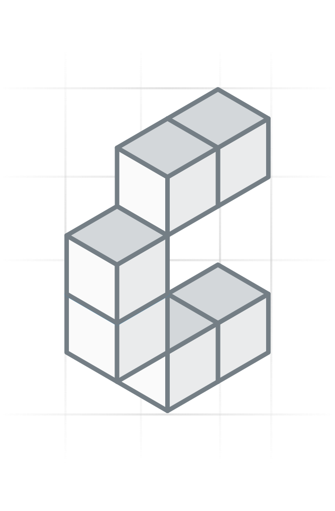

# graphile-meta

<p align="center" width="100%">
  
</p>

<p align="center" width="100%">
  <a href="https://github.com/constructive-io/constructive/actions/workflows/run-tests.yaml">
    
  </a>
   <a href="https://github.com/constructive-io/constructive/blob/main/LICENSE"></a>
   <a href="https://www.npmjs.com/package/graphile-meta"></a>
</p>

PostGraphile v5 plugin exposing a single `_meta` root query that describes each table exposed by the final GraphQL schema, including fields, indexes, constraints, relations, inflection names, root query/mutation names, and smart-tag-derived metadata (storage, search, i18n, realtime).

## Overview

Standard GraphQL introspection tells you about the GraphQL schema — `_meta` adds the **database identities** behind its exposed objects. `MetaSchemaPlugin` reconciles the PostGraphile registry with the final executable schema and caches a `TableMeta` entry per exposed table, covering:

- **Tables and fields** — exact PostgreSQL names alongside final GraphQL names, plus Postgres type, GraphQL type, nullability, defaults, primary/foreign key flags, and scalar encoding hints (how to serialize bigints, datetimes, vectors, geojson, …)
- **Form metadata** — allowed values from CHECK constraints, whether the create input requires a field, which fields create and update accept, and whether a table is a junction
- **Indexes & constraints** — primary key, unique constraints, foreign keys with referenced tables
- **Relations** — `belongsTo`, `hasOne`, `hasMany`, and `manyToMany` with the exact generated field names
- **Inflection** — the type names and root field names PostGraphile generated (`tableType`, `allRows`, `connection`, `createInputType`, …)
- **Root operations** — the query/mutation names for `all`, `one`, `create`, `update`, `delete`
- **Feature metadata from smart tags** — `storage` (`@storageFiles` / `@storageBuckets`), `search` (tsvector/BM25/pg_trgm/pgvector columns), `i18n` (translation tables and translatable fields), and `realtime` (subscription field names)

The first `_meta` execution reconciles metadata against that request's final schema; subsequent requests for the same schema return the cached result. Schema construction also seeds the legacy metadata cache for existing codegen consumers.

## Why it exists: dynamic queries

`_meta` exists to power **dynamic queries** with [`@constructive-io/graphql-query`](https://github.com/constructive-io/constructive/tree/main/graphql/query): clients introspect `_meta` at runtime and build queries/mutations on the fly — no generated code, no build step. It is also the backbone of [`@constructive-io/graphql-codegen`](https://github.com/constructive-io/constructive/tree/main/graphql/codegen), which uses `_meta` to generate typed ORMs, React Query hooks, and CLIs.

## Usage

Extend your preset with `MetaSchemaPreset` (already included in `ConstructivePreset` from `graphile-settings`):

```typescript
import { MetaSchemaPreset } from 'graphile-meta';

const preset: GraphileConfig.Preset = {
  extends: [MetaSchemaPreset],
};
```

### Querying `_meta`

```graphql
query {
  _meta {
    tables {
      name
      tableName
      schemaName
      fields {
        name
        columnName
        type { pgType gqlType isArray }
        isNotNull
        hasDefault
        isPrimaryKey
        isForeignKey
        allowedValues
        isRequiredOnCreate
        isWritableOnCreate
        isWritableOnUpdate
      }
      isJunction
      indexes { name isUnique isPrimary columns }
      constraints {
        primaryKey { name }
        unique { name }
        foreignKey { name referencedTable }
      }
      relations {
        belongsTo { fieldName references { name } }
        hasMany { fieldName referencedBy { name } }
        manyToMany { fieldName rightTable { name } }
      }
      inflection { tableType allRows connection edge createInputType }
      query { all one create update delete }
      storage { isFilesTable isBucketsTable }
      search { algorithms columns { name algorithm } hasUnifiedSearch }
      i18n { translationTable translatableFields { name type } }
      realtime { subscriptionFieldName }
    }
  }
}
```

Example response snippet:

```json
{
  "_meta": {
    "tables": [
      {
        "name": "User",
        "tableName": "users",
        "schemaName": "app_public",
        "fields": [
          { "name": "id", "columnName": "id", "type": { "pgType": "uuid", "gqlType": "UUID", "isArray": false }, "isNotNull": true, "hasDefault": true, "isPrimaryKey": true, "isForeignKey": false },
          { "name": "displayName", "columnName": "display_name", "type": { "pgType": "text", "gqlType": "String", "isArray": false }, "isNotNull": true, "hasDefault": false, "isPrimaryKey": false, "isForeignKey": false }
        ],
        "inflection": { "tableType": "User", "allRows": "users", "connection": "UserConnection" },
        "query": { "all": "users", "one": null, "create": "createUser", "update": "updateUser", "delete": "deleteUser" }
      }
    ]
  }
}
```

`name` and `fields.name` are final GraphQL names. `tableName` and
`fields.columnName` preserve the corresponding PostgreSQL identifiers. An
operation under `query` is `null` when that field was not emitted in the final
GraphQL schema.

### Form metadata

These fields let a generic client build correct create and edit forms from `_meta` alone. Their GraphQL descriptions are public copy that says only what a client may rely on; the rules below are how the values are derived.

These form fields only describe what the final schema exposes: a column hidden from the API (no select behavior, or no field on the table's type) and a table without an output type contribute nothing to them, so none of their values hints that hidden columns or tables exist. That holds for these fields only. The older metadata (indexes, constraints, foreign keys and scope) isn't filtered by visibility, so it can still name columns or tables the API hides.

- **`MetaField.allowedValues`** lists the values that simple single-column CHECK constraints permit on a text, varchar or char column: `col IN ('a', 'b')`, `col = ANY (ARRAY['a', 'b'])`, `col = ANY ('{a,b}'::text[])` and `col = 'a' OR col = 'b'`. It's read at gather time from the constraint expressions introspection already carries, so `_meta` runs no extra query, and only the values are reported, never the constraint's name or expression. Several simple constraints on one column intersect. When any other single-column CHECK on the column can't be read that way, it may reject listed values too, so the field is `null`; it's also `null` when no simple constraint applies.
- **`MetaField.isRequiredOnCreate`** is true when the field is non-null in the table's create input type, so a create must supply it. The record input is found by its inflected name (`tableFieldName`, and `patchField` of it for updates), never by guessing among the input's fields; when it can't be found the flags are `null`. It follows the input PostGraphile actually built rather than `NOT NULL`: a column a trigger fills (`@behavior -insert`) or one with a default is `NOT NULL` but not required.
- **`MetaField.isWritableOnCreate` / `isWritableOnUpdate`** say whether the create input and the patch type have the field.

  These four are set on the fields under `MetaTable.fields` and are `null` on the fields nested in indexes, constraints and relations.
- **Detected many-to-many relations.** A table is a detected junction when its exposed non-system columns are exactly the local columns of two foreign keys whose relations have the select behavior. A column is a system column when a client never picks its value in a form:
  1. it's a surrogate key: in the primary key and in no foreign key (a primary key made of the two foreign keys is the classic junction);
  2. the database generates its value: identity, serial and generated columns, and any default that isn't a constant, which covers `gen_random_uuid()` ids, `owner_id DEFAULT current_user_id()` and `created_at`/`updated_at DEFAULT now()`. A constant default (`quantity DEFAULT 1`, `status DEFAULT 'pending'`, including casts like `'{}'::jsonb`) is a starting value the client may change, so that column is data;
  3. the create input can't set it (`@behavior -insert`);
  4. it's the table's `@scope` key column.

  Foreign keys on system columns, such as `owner_id` referencing users, don't count. A timestamp with no default that clients write (e.g. `checked_in_at`) is data, so a table carrying one isn't a junction. A detected junction adds a `relations.manyToMany` entry to each of the two tables it links, even when the many-to-many plugin doesn't create one, but only when the junction has its create mutation and the junction, both linked tables and every key column on either side are exposed. Both constraints in the entry are the junction's own foreign keys, so it never depends on, or names, a backward relation the API hides (PostGraphile serves a backward relation, a has-one or has-many, only when an index covers the foreign key columns). `fieldName` and `type` are `null` when the final schema has no field for the relation.
- **`MetaTable.isJunction`** is true exactly when a reported `manyToMany` relation, declared by the many-to-many plugin or detected, names the table as its junction.

### Grid metadata

These fields let a generic grid read and edit any table without guessing names or keys. All are additive: a client that doesn't select them sees no change.

- **`MetaTable.kind`** is `view` for a view or materialized view and `table` otherwise, read from the resource's `isView` / `isMaterializedView` extensions.
- **`MetaTable.description`** is the table comment with its smart tags removed, or `null` (a comment made only of smart tags gives `null`).
- **`MetaBelongsToRelation.refKeys`** are the referenced columns on the other table, in the order of `keys`, so a composite foreign key, or one that points at a unique non-key column (`assignee_email → people.email`), pairs up column by column.
- **`MetaHasRelation.remoteKeys`** are the foreign key columns on the related table, in the order of `keys`. `keys` are this table's referenced columns, so with two foreign keys to the same table (`owner_id`, `reviewer_id`) only `remoteKeys` tells the two relations apart.

  Like `keys` and the foreign key constraints whose columns they repeat, `refKeys` and `remoteKeys` aren't filtered by visibility: they name every key column, even one the other table hides, so each list pairs with `keys` position by position. A client checks each name against the other table's `fields` before it links records through the relation.
- **`MetaField.isComputed`** is true when the database always computes the value and rejects a written one: a generated column (stored or virtual), or an identity `ALWAYS` column. It is read at gather time from `pg_attribute`. It is narrower than the generated-value rule above: identity `BY DEFAULT` and defaults such as `now()` fill a value only when none is written, so they are not computed. PostGraphile still puts a generated column in the create and patch inputs, so `isWritableOnCreate` / `isWritableOnUpdate` stay true for it (they describe the inputs). A client must not offer a write when `isComputed` is true. Set on `MetaTable.fields` only.
- **`MetaField.file`** is set when the column's type is one of the Constructive file domains: `image` or `upload` (domains over jsonb that hold a file document) or `attachment` (a domain over text that holds a link), or a list of one (`isMultiple`). A domain with one of those names over another type isn't a file column. `filesType` is the GraphQL type of the storage files table when the API serves exactly one, else `null`. Like the form fields it is set on `MetaTable.fields` only.
- **`MetaScalarEncoding.dotPath`** says how a tree path (`ltree`) column is served, asked of the column's own codec: `false` when it serves slash paths (`/top/science`, what the Constructive preset serves for a plain `ltree` column), `true` for dotted paths (`top.science`). A list of paths (`ltree[]`) or a domain over `ltree` keeps the codec it was built from, so it still serves dotted paths. That is why the answer is per column, not per type. `null` when the codec serves neither form.
- **`MetaType.maxLength`, `precision`, `scale`** and **`MetaScalarEncoding.srid`, `dimensions`** come from the column's type modifier, read at gather time: `varchar(n)`/`char(n)` give `maxLength` in characters, `bit(n)`/`varbit(n)` in bits, `numeric(p,s)` gives `precision` and `scale` (scale may be negative), `geometry`/`geography` give `srid` when one is declared, and `vector(n)` gives `dimensions`. An array column carries its element's limits. All are `null` when nothing is declared. A domain's own type modifier (`CREATE DOMAIN d AS varchar(10)`) isn't read.

### Pairing with @constructive-io/graphql-query

```typescript
import { convertFromMetaSchema, validateMetaObject } from '@constructive-io/graphql-query';

// Fetch the _meta query result once at runtime, convert it to a meta object,
// then drive dynamic query/mutation generation from it
const metaObject = convertFromMetaSchema(metaQueryResult);
const { valid } = validateMetaObject(metaObject);
```

## Exports

| Export | Description |
|--------|-------------|
| `MetaSchemaPlugin` | The plugin (default export too) |
| `MetaSchemaPreset` | Preset wrapping the plugin |
| `TableMeta`, `FieldMeta`, `TypeMeta`, `IndexMeta`, `ConstraintsMeta`, `RelationsMeta`, `InflectionMeta`, `QueryMeta`, … | Type contracts for the `_meta` payload |

## Related

- [`graphile-settings`](https://github.com/constructive-io/constructive/tree/main/graphile/graphile-settings) — re-exports this plugin as part of `ConstructivePreset`
- [`@constructive-io/graphql-query`](https://github.com/constructive-io/constructive/tree/main/graphql/query) — runtime dynamic query building driven by `_meta`
- [`@constructive-io/graphql-codegen`](https://github.com/constructive-io/constructive/tree/main/graphql/codegen) — code generation driven by `_meta`
