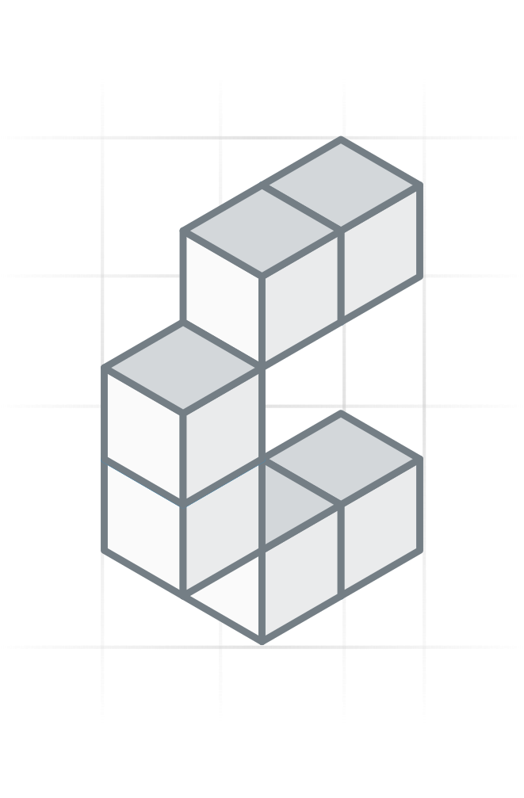

# graphile-search

<p align="center" width="100%">
  
</p>

<p align="center" width="100%">
  <a href="https://github.com/constructive-io/constructive/actions/workflows/run-tests.yaml">
    
  </a>
   <a href="https://github.com/constructive-io/constructive/blob/main/LICENSE"></a>
   <a href="https://www.npmjs.com/package/graphile-search"></a>
</p>

Unified PostGraphile v5 search plugin — abstracts tsvector, BM25, pg_trgm, and pgvector behind a single adapter-based architecture with composite `searchScore`.

## Overview

Instead of separate plugins per algorithm, `graphile-search` uses an **adapter pattern** where each search algorithm (tsvector, BM25, pg_trgm, pgvector) implements a ~50-line adapter. A single core plugin iterates all adapters and wires them into the Graphile v5 hook system.

## Usage

```typescript
import { UnifiedSearchPreset } from 'graphile-search';

const preset = {
  extends: [
    UnifiedSearchPreset(),
  ],
};
```

### Custom configuration

```typescript
import { UnifiedSearchPreset } from 'graphile-search';

const preset = {
  extends: [
    UnifiedSearchPreset({
      tsvector: { filterPrefix: 'fullText', tsConfig: 'english' },
      bm25: true,
      trgm: { defaultThreshold: 0.2 },
      pgvector: { defaultMetric: 'COSINE' },
      searchScoreWeights: { bm25: 0.5, trgm: 0.3, tsv: 0.2 },
    }),
  ],
};
```

## Features

- **4 search algorithms** via adapters: tsvector (ts_rank), BM25 (pg_textsearch), pg_trgm (similarity), pgvector (distance)
- **Per-algorithm score fields**: `{column}{Algorithm}{Metric}` (e.g. `bodyBm25Score`, `titleTrgmSimilarity`)
- **Composite `searchScore`**: Normalized 0..1 aggregating all active search signals
- **OrderBy enums**: `{COLUMN}_{ALGORITHM}_{METRIC}_ASC/DESC` + `SEARCH_SCORE_ASC/DESC` (see [Ordering by a score](#ordering-by-a-score))
- **Filter fields**: `{algorithm}{Column}` on connection filter input types
- **Hybrid search**: Combine multiple algorithms in a single query
- **Zero config**: Auto-discovers columns and indexes per adapter

## Ordering by a score

A search orderBy sorts by the score its filter computes, so it needs that filter in `where`: `BODY_BM25_SCORE_ASC` needs `bm25Body` (or `unifiedSearch`), `SEARCH_SCORE_DESC` needs any search filter. A search orderBy without its filter is an error that names the filter to add.

`SEARCH_SCORE_ASC/DESC` orders by the same Reciprocal Rank Fusion sum that `searchScore` displays, so `first`/`offset` paging returns the best rows first. Because the sum is built from window functions, `SEARCH_SCORE_*` cannot be combined with cursor paging (`after`/`before`); use `offset`, or a per-adapter orderBy for cursors.

When a column is scored by both its own filter (e.g. `bm25Body`) and `unifiedSearch`, the explicit filter's score is the one displayed and ordered by; the column is scored once per query.

Limitation: in a *literal* `orderBy` list, plain column terms are planned before search-score terms, so `[EMBEDDING_VECTOR_DISTANCE_ASC, ROW_ID_ASC]` sorts by `ROW_ID` first. Pass `orderBy` as a GraphQL variable to keep the requested order, or do not mix search terms with column terms in a literal list.

## Architecture

```
┌─────────────────────────────────────┐
│        Unified Search Plugin        │
│  (iterates adapters, wires hooks)   │
├─────────────────────────────────────┤
│ Adapter: tsvector  │ Adapter: bm25  │
│ Adapter: trgm      │ Adapter: vector│
└─────────────────────────────────────┘
```

Each adapter implements the `SearchAdapter` interface:
- `detectColumns()` — discover eligible columns on a table
- `registerTypes()` — register custom GraphQL input types
- `getFilterTypeName()` — return the filter input type name
- `buildFilterApply()` — generate WHERE + score SQL fragments
