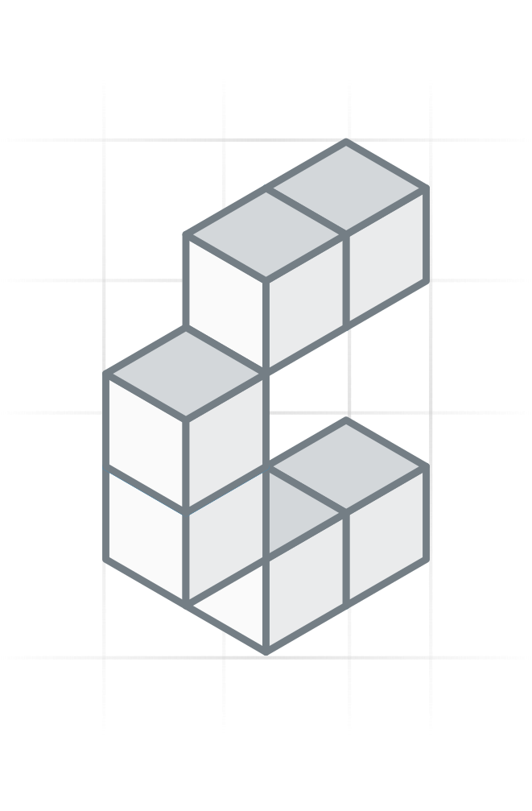

# @constructive-io/graphql-env

<p align="center" width="100%">
  
</p>

<p align="center" width="100%">
  <a href="https://github.com/constructive-io/constructive/actions/workflows/run-tests.yaml">
    
  </a>
   <a href="https://github.com/constructive-io/constructive/blob/main/LICENSE"></a>
   <a href="https://www.npmjs.com/package/@constructive-io/graphql-env"></a>
</p>

Constructive environment configuration with GraphQL/Graphile support.

This package extends `@pgpmjs/env` with GraphQL-specific environment variable parsing and defaults for Constructive applications.

## Installation

```bash
npm install @constructive-io/graphql-env
```

## Usage

```typescript
import { getEnvOptions } from '@constructive-io/graphql-env';

// Get merged options (core PGPM + GraphQL defaults + env vars + config)
const options = getEnvOptions();

// With overrides
const options = getEnvOptions({
  graphile: { schema: ['public', 'app'] },
  features: { simpleInflection: true }
});
```

## Environment Variables

In addition to all environment variables supported by `@pgpmjs/env`, this package parses:

### GraphQL Schema
- `GRAPHILE_SCHEMA` - Comma-separated list of PostgreSQL schemas to expose
- `GRAPHILE_CACHE_MAX` - Positive safe integer cap on the number of cached plans
- `GRAPHILE_CACHE_TTL_MS` - Positive safe integer resident lifetime in milliseconds
- `GRAPHILE_CACHE_HEAP_MAX_BYTES` - Positive safe integer heap limit in bytes used to size the cache
- `GRAPHILE_CACHE_BUILD_RESERVE_BYTES` - Nonnegative safe integer heap reserve in bytes for schema builds

These variables map to `graphile.cache.max`, `graphile.cache.ttl`,
`graphile.cache.heapMaxBytes`, and `graphile.cache.buildReserveBytes`. The same values can be set in `pgpm.json` or
runtime options. If both heap byte values are explicit, the build reserve must
be smaller than the heap limit; when no heap limit is set, the cache runtime
derives it from the V8 heap limit.

When omitted, the cache owner defaults `max` to `50` and `ttl` to five minutes
in development or 366 days in other environments. Precedence is defaults,
configuration file, environment variables, then runtime options. Explicit
cache environment values must be positive safe integers (except the
nonnegative build reserve); malformed values fail option resolution.

Graphile schema build coordination can also be configured through:

- `GRAPHILE_BUILD_QUEUE_MAX` - Nonnegative safe integer maximum queue size
- `GRAPHILE_BUILD_WATCHDOG_MS` - Positive timeout in milliseconds, at most `2147483647`
- `GRAPHILE_BUILD_SHUTDOWN_TIMEOUT_MS` - Positive shutdown wait in milliseconds, at most `2147483647`

These map to `graphile.build.queueMax`, `graphile.build.watchdogMs`, and
`graphile.build.shutdownTimeoutMs`. Unset variables preserve `pgpm.json` and
runtime options. Defaults are applied by the Graphile runtime: queue size `16`,
watchdog `300000` ms, and shutdown timeout `30000` ms.

The server always uses schema-scoped introspection for its `main` PostgreSQL
service: each handler introspects only its API's schemas and their dependency
closure. There is no switch back to stock introspection (`main: false` is
rejected), because stock introspection retains the whole database in every
cached handler. The scoped options are configured through the Graphile preset
in `pgpm.json` or runtime options under
`graphile.preset.gather.pgScopedIntrospection.main`.

### Scoped introspection environment overrides

The server maps these variables to
`graphile.preset.gather.pgScopedIntrospection.main`. `main` is the internal
PostgreSQL service name, not the routing service name (such as `local`).

| Variable | Accepted values |
| --- | --- |
| `GRAPHILE_SCOPED_INTROSPECTION_CATALOG_TYPES` | `all` or `dependency-closure` |
| `GRAPHILE_SCOPED_INTROSPECTION_CAPABILITY_EXTENSIONS` | Comma-separated extension names, e.g. `pg_trgm,vector` |

- Unset variables do not override `pgpm.json`. With neither, the server uses
  Crystal's defaults (`catalogTypes: "all"`).
- Each variable overrides only its own field. Extension lists replace the
  configured array, trim names and remove duplicates. An explicitly empty or
  whitespace-only extension variable clears the list to `[]`; unset preserves it.
- Catalog values must match one of the two lowercase choices exactly; an empty
  catalog value is invalid. Empty CSV items such as `pg_trgm,,vector` are invalid.
  Invalid settings fail option resolution with the variable name.
- Precedence remains defaults < config file < environment < explicit runtime
  options. These variables affect only `main`.

```bash
export GRAPHILE_SCOPED_INTROSPECTION_CATALOG_TYPES=dependency-closure
export GRAPHILE_SCOPED_INTROSPECTION_CAPABILITY_EXTENSIONS=pg_trgm,vector
```

Restart the server after changing its environment. `capabilityExtensions`
retains introspection metadata for extension capabilities; it does not install
PostgreSQL extensions or change the API's exposed schemas.

### Grafast Cache Limits
- `GRAPHILE_QUERY_CACHE_MAX_LENGTH` - Maximum parsed and validated queries retained per schema
- `GRAPHILE_OPERATIONS_CACHE_MAX_LENGTH` - Maximum operations retained for plan lookup per schema
- `GRAPHILE_OPERATION_PLANS_CACHE_MAX_LENGTH` - Maximum context/variable-specific plans retained per operation

Each cache limit must be a safe integer of at least `2`. When omitted, Grafast's
upstream default for that cache remains in effect.

### Grafast Explain
- `GRAPHILE_EXPLAIN` - Allow clients to request Grafast plan/SQL output via the `x-graphql-explain` header (off unless set)

### Feature Flags
- `FEATURES_SIMPLE_INFLECTION` - Enable simple inflection plugin
- `FEATURES_OPPOSITE_BASE_NAMES` - Enable opposite base names
- `FEATURES_POSTGIS` - Enable PostGIS support

### API Configuration
- `API_IS_PUBLIC` - Whether API is public
- `API_EXPOSED_SCHEMAS` - Comma-separated list of exposed schemas
- `API_META_SCHEMAS` - Comma-separated list of meta schemas
- `API_ANON_ROLE` - Anonymous role name
- `API_ROLE_NAME` - Default role name
- `API_FLUSH_TOKEN` - Bearer token required by `POST /flush`; the route is not mounted when unset
- `API_INTROSPECTION_ROLE` - Role PostGraphile introspects as; unset means the pool's connecting role

## Defaults

GraphQL defaults are provided by `@constructive-io/graphql-types`:

```typescript
{
  graphile: {
    schema: [],
    extends: [],
    preset: {},
    cache: {
      max: 50,
      ttl: 300000 // development; 31622400000 (366 days) otherwise
    }
  },
  features: {
    simpleInflection: true,
    oppositeBaseNames: true,
    postgis: true
  },
  api: {
    exposedSchemas: [],
    anonRole: 'administrator',
    roleName: 'administrator',
    isPublic: true,
    metaSchemas: ['routing_public', 'metaschema_public', 'metaschema_modules_public']
  }
}
```

For example, this enables scoped introspection with the defaults for the
server's default `main` service:

```json
{
  "graphile": {
    "preset": {
      "gather": {
        "pgScopedIntrospection": { "main": true }
      }
    }
  }
}
```

Advanced options can be supplied when a service needs a specific catalog
policy or extension capability:

```json
{
  "graphile": {
    "preset": {
      "gather": {
        "pgScopedIntrospection": {
          "main": {
            "catalogTypes": "dependency-closure",
            "capabilityExtensions": ["pg_trgm"]
          }
        }
      }
    }
  }
}
```

## When to Use

- Use `@constructive-io/graphql-env` for Constructive applications that need GraphQL/Graphile configuration
- Use `@pgpmjs/env` for pure PGPM tooling that doesn't need GraphQL support
