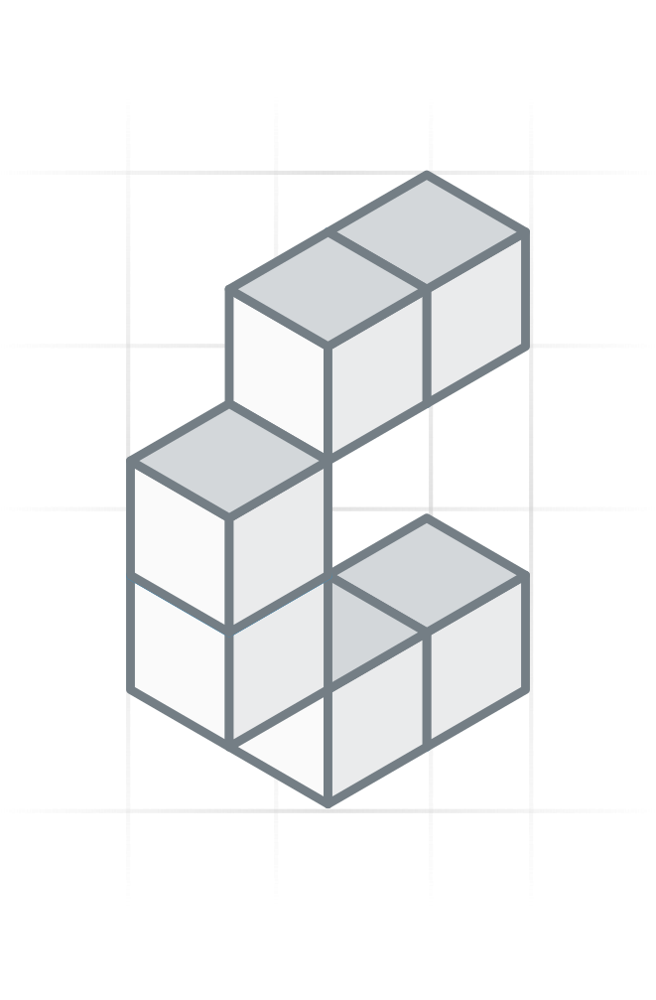

# @constructive-io/graphql-server

<p align="center" width="100%">
  
</p>

<p align="center" width="100%">
  <a href="https://github.com/constructive-io/constructive/actions/workflows/run-tests.yaml">
    
  </a>
   <a href="https://github.com/constructive-io/constructive/blob/main/LICENSE"></a>
   <a href="https://www.npmjs.com/package/@constructive-io/graphql-server"></a>
</p>

**Constructive GraphQL Server** is an Express-based server built on PostGraphile. It reads Constructive metadata to select API schemas, applies RLS-aware auth, and exposes a production-ready GraphQL API.

## 🚀 Quick Start

### Use as SDK

Install the package:

```bash
pnpm add @constructive-io/graphql-server @constructive-io/graphql-env
```

Start a server:

```ts
import { getEnvOptions } from '@constructive-io/graphql-env';
import { GraphQLServer } from '@constructive-io/graphql-server';

GraphQLServer(
  getEnvOptions({
    pg: { database: 'constructive_db' },
    server: { host: '0.0.0.0', port: 3000 },
  })
);
```

> **Tip:** Set `PGHOST`, `PGPORT`, `PGUSER`, `PGPASSWORD`, `PGDATABASE` to control DB connectivity.
> See [Configuration](#configuration) for the full list of supported env vars and defaults.

### Local Development (this repo)

```bash
pnpm install
cd graphql/server
pnpm dev
```

This starts the server with env defaults from `@constructive-io/graphql-env`.

> **Tip:** Set `PGHOST`, `PGPORT`, `PGUSER`, `PGPASSWORD`, `PGDATABASE` to control DB connectivity.
> See [Configuration](#configuration) for the full list of supported env vars and defaults.

## What it does

Platform deployments connect through one pgpm-provisioned `NOSUPERUSER INHERIT
NOBYPASSRLS` login, configured only with `PGUSER`/`PGPASSWORD`. Startup and
routing queries run as that login, so rows behind member RLS stay hidden from
it: standing and routing settings are read through static, login-only
`SECURITY DEFINER` readers in `function_resolution`. Requests switch to
`authenticated` or `anonymous`, so PostgreSQL enforces their RLS policies.

Runs an Express server that wires CORS, uploads, domain parsing, auth, and PostGraphile into a single GraphQL endpoint. It serves `/graphql` and `/graphiql`, injects per-request `pgSettings`, and flushes cached schemas on demand or via database notifications. When meta API is enabled, it resolves API config (schemas, roles, modules) from the meta schema using the request host and enforces `api.isPublic`, with optional header overrides in private mode; when meta API is disabled, it serves the fixed schemas and roles from `api.exposedSchemas`, `api.anonRole`, and `api.roleName`.

## Key Features

- Automatic GraphQL API generation from PostgreSQL schemas
- RLS-aware authentication and per-request `pgSettings`
- Meta-schema routing by domain + subdomain
- GraphiQL and health check endpoints
- Schema cache flush via `/flush` or database notifications
- Opt-in observability for memory, DB activity, and Graphile build debugging

## Observability

`@constructive-io/graphql-server` includes an opt-in observability mode for local debugging.

- Master switch: `GRAPHQL_OBSERVABILITY_ENABLED=true`
- Debug routes: `GET /debug/memory`, `GET /debug/db`
- Background sampler: periodic NDJSON snapshots under `graphql/server/logs/`
- CLI helpers:
  - `pnpm debug:memory:analyze`
  - `pnpm debug:heap:capture`

Observability only activates when all of the following are true:

- `GRAPHQL_OBSERVABILITY_ENABLED=true`
- `NODE_ENV=development`
- the server is bound to a loopback host such as `localhost`, `127.0.0.1`, or `::1`

When those conditions are not met, the debug routes are not mounted and the sampler does not start. This keeps the default runtime surface minimal and prevents the observability layer from being exposed remotely.

For the operational workflow, sampler output, and heap snapshot usage, see [docs/memory-debugging.md](./docs/memory-debugging.md).

## Routes

- `GET /healthz` -> health check
- `GET /graphiql` -> GraphiQL UI
- `GET /graphql` / `POST /graphql` -> GraphQL endpoint
- `POST /flush` -> clears cached Graphile schema for the current API; mounted only when `API_FLUSH_TOKEN` is set, and requires `Authorization: Bearer $API_FLUSH_TOKEN`. Without the variable the route is not served (404) — operators deploying a schema-cache flush must set it on the server and on every caller. The `LISTEN/NOTIFY` invalidation path is unaffected.
- `GET /debug/memory` -> memory/process/Graphile debug snapshot when observability is enabled
- `GET /debug/db` -> PostgreSQL activity/locks/pool debug snapshot when observability is enabled

## Auth cookies and CSRF

Browsers authenticate with the `constructive_session` cookie; every other client sends `Authorization: Bearer <accessToken>`.

- A successful sign-in mutation (`signIn`, `signUp`, `signInSso`, `signInMagicLink`, `signInEmailOtp`, `completeMfaChallenge`, …) returns the access token in the response body and also sets `constructive_session` (plus `constructive_device_token` when the mutation returns a device id). `Max-Age` comes from the API's auth settings (default 86400 s; `rememberMe: true` uses the remember-me duration).
- `signOut` always answers with expired `constructive_session` and `constructive_device_token` cookies (`Max-Age=0`), however the request authenticated and whether or not the mutation succeeded. `revokeSession` / `revokeAllSessions` clear them on success.
- Every request gets a `csrf_token` cookie (readable by JS, one day). A `POST /graphql` that carries `constructive_session` and no Bearer header must echo that value in `X-CSRF-Token`, or it is refused with 403 `CSRF_TOKEN_MISSING` / `CSRF_TOKEN_INVALID`. Bearer requests and requests without a session cookie skip the check.

### Non-browser clients (native apps, CLIs, servers)

Send `X-Constructive-Session-Cookie: omit` on every request. Sign-in mutations then set no auth cookie: read `accessToken` from the response body and send it as `Authorization: Bearer <accessToken>`. Any other value of the header is refused with 400 `INVALID_SESSION_COOKIE_HEADER` before the operation runs. The header does not bypass CSRF: a request that still carries `constructive_session` without a Bearer header is checked like a browser's, so sign out with the Bearer token (its response expires any session cookie the client was given before it opted out).

## Scoped routing

This is a production-only server: every request is resolved through the scoped-routing plane. There is no static single-tenant mode and no flag to disable routing. For single-database local development without route resolution or a database id, use [`@constructive-io/graphql-dev-server`](../dev-server/README.md).

- The server resolves the request host with a single `resolve_route()` call against the compiled route bindings in `routing_public`, mapping host → tenant/api/database/role.
- Only APIs where `api.is_public` matches `API_IS_PUBLIC` are served.
- In private mode (`API_IS_PUBLIC=false`), you can override with headers:
  - `X-Api-Name` + `X-Database-Id`
  - `X-Schemata` + `X-Database-Id`
  - `X-Meta-Schema` + `X-Database-Id`
- A resolved database id is always required. There is no default database, so a request that resolves without a database id is rejected (`NO_DATABASE_ID` → HTTP 500).

## Configuration

Configuration is merged from defaults, config files, and env vars via `@constructive-io/graphql-env`. See `graphql/env/README.md` for the full list and examples.

| Env var                        | Purpose                               | Default                                                       |
| ------------------------------ | ------------------------------------- | ------------------------------------------------------------- |
| `PGHOST`                       | Postgres host                         | `localhost`                                                   |
| `PGPORT`                       | Postgres port                         | `5432`                                                        |
| `PGUSER`                       | Postgres user                         | `postgres`                                                    |
| `PGPASSWORD`                   | Postgres password                     | `password`                                                    |
| `PGDATABASE`                   | Postgres database                     | `postgres`                                                    |
| `GRAPHILE_SCHEMA`              | Comma-separated schemas to expose     | empty                                                         |
| `FEATURES_SIMPLE_INFLECTION`   | Enable simple inflection              | `true`                                                        |
| `FEATURES_OPPOSITE_BASE_NAMES` | Enable opposite base names            | `true`                                                        |
| `FEATURES_POSTGIS`             | Enable PostGIS support                | `true`                                                        |
| `API_IS_PUBLIC`                | Serve public APIs only                | `true`                                                        |
| `API_EXPOSED_SCHEMAS`          | Additional schemas to expose          | empty                                                         |
| `API_META_SCHEMAS`             | Meta schemas to query                 | `routing_public,metaschema_public,metaschema_modules_public` |
| `API_ANON_ROLE`                | Anonymous role name                   | `administrator`                                               |
| `API_ROLE_NAME`                | Authenticated role name               | `administrator`                                               |
| `API_FLUSH_TOKEN`              | Bearer token required by `POST /flush`; route is not mounted when unset | empty                        |
| `API_INTROSPECTION_ROLE`       | Role PostGraphile introspects as; unset means the pool's connecting role. Naming a role with fewer grants removes fields from the schema | empty |
| `GRAPHQL_OBSERVABILITY_ENABLED` | Master switch for debug routes and sampler | `false`                                                  |
| `GRAPHQL_DEBUG_SAMPLER_ENABLED` | Enables periodic NDJSON sampling when observability is on | `true`                                   |
| `GRAPHQL_DEBUG_SAMPLER_INTERVAL_MS` | Sampler interval in milliseconds | `10000`                                                       |
| `GRAPHQL_DEBUG_SAMPLER_DIR`    | Override output directory for sampler logs | `graphql/server/logs`                                     |

## Testing

Use `supertest` or your HTTP client of choice against `/graphql`. For RLS-aware tests, provide a `Bearer` token and ensure the API's auth function is available.

## Related Packages

- `@constructive-io/graphql-env` - env parsing + defaults for GraphQL
- `@constructive-io/graphql-types` - shared types and defaults
- `graphile-settings` - PostGraphile configuration
- `graphile-meta-schema` - meta schema support
